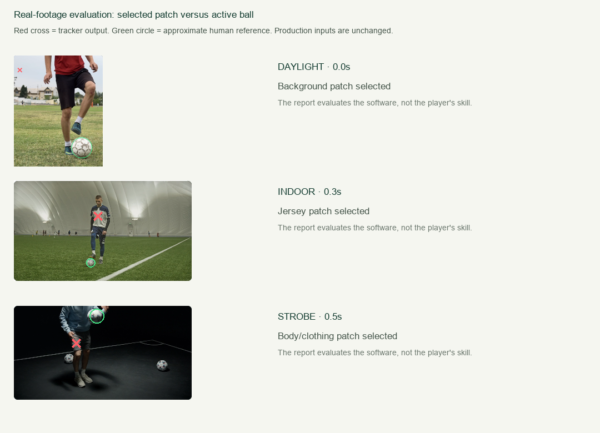

# Real-footage screening of Football Helper

**October 13, 2026 · Existing `contrast-ball-1` implementation · No algorithm tuning**

The current automatic tracker failed this three-case screening. It frequently selected clothing or background patches instead of the active ball, and every excerpt failed the existing coverage/gap gates. Local video decoding and the manual review path worked. No athlete score was created.

This is a small diagnostic study, not a validated accuracy benchmark. It should guide the next engineering work rather than support a public performance claim.

> **Addendum (October 13, 2026):** this report describes the frozen `contrast-ball-1` tracker. The follow-up with a tracking fix and a local ball detector is in [REPORT-detector.md](REPORT-detector.md). `evaluate.py` below refuses to run against the changed production files, by design.

## Three conditions and their results

Each run used an unchanged three-second excerpt, 0.0–3.0 s, sampled at 10 Hz: 30 frames per clip, 90 total. A single ball seed and approximate radius were chosen from the first frame before observing results. The existing native browser decoding, canvas scaling, colour/shape tracker, API and assessment rules were used directly through the app.

| Condition | Visible space and framing | Tracker coverage | Longest gap | Correct ball selections in detection audit | App result |
|---|---|---:|---:|---:|---|
| Diffuse outdoor daylight | Open grass field; tight portrait crop, head excluded; ball sometimes leaves the side edge | 12/30 = **40.0%** | **1.3 s** | **0/12** checkable detections | `UNMEASURABLE` |
| Artificial indoor dome light | Large indoor pitch; wide full-player view, small ball, white line and other players in background | 14/30 = **46.7%** | **0.7 s** | **1/14** = 7.1% | `UNMEASURABLE` |
| Low-key/strobe studio light | Limited studio view; alternating dark frames, cropped body and two other balls | 6/30 = **20.0%** | **1.5 s** | **1/5** = 20.0%; **one additional detection unknown** | `UNMEASURABLE` |

Coverage means a colour/shape component was returned. It does **not** mean the ball was correctly tracked. The audit above checks all emitted detections; unjudgeable dark output is excluded from its precision denominator. The small denominators make percentages unstable, and the studio percentage does not establish that low light performs better.

The quality gate requires at least 85% coverage, no gap longer than 0.35 s, adequate source resolution and enough frames. All three cases failed coverage and gap requirements, so **zero contact proposals were released**. There were also zero ungated turning-point proposals in these particular incomplete traces.

### Independent reference checks

Before running the tracker, one reviewer recorded ten uniform spot checks per clip at 0.0, 0.3, …, 2.7 s. Approximate active-ball centres/radii were recorded in tracking-canvas pixels. A centre was considered to select the visible ball when it fell within the reference radius plus four pixels. This is an instance-selection check, not precise trajectory validation.

Twenty-two of the thirty spot checks were scorable: nine outdoors, ten indoors and three in the studio. One outdoor ball was partly outside the frame, and seven sampled studio frames had unclear boundaries in darkness. Of the eight detections returned at scorable spot-check times, **none selected the active ball**. This is a spot-check result; it is not a claim that no frame ever contained a correct detection. The subsequent audit of all 32 emitted detections found the two correct selections shown above, 29 wrong selections, and one unknown.

References have about 2–4 pixels of centre uncertainty, which matters especially for the indoor ball's approximately eight-pixel radius. There was one reviewer, no second annotation pass by an independent person, and no licensed-coach validation. See [reference.json](reference.json), [detection-audit.json](detection-audit.json), and [spot-checks.csv](spot-checks.csv) for the exact decisions.

### Contact/rep findings

- The outdoor page calls its clip juggling, but the inspected excerpt shows ground ball control and stepovers. It was retained as a **negative control**: no airborne juggling contacts should be proposed. None were emitted. The app rejected the track; it did not automatically recognize the drill as a negative control.
- In the indoor clip, three clear boot contacts were labelled in the 1.0–3.0 s interval, at approximately **1.38, 2.02 and 2.78 s**. Initial pickup/quick touches around 0.44–0.84 s were excluded because they were less certain at this spatial resolution. The app emitted no proposals, so it recovered **0/3** clear reference contacts. This is abstention following a failed track, not a measured three-rep score of zero.
- A complete reliable studio contact count could not be established because flashes and crops hid some contact instants. Rep accuracy is **not reported** for that clip.

The three-second runs were diagnostics, not complete 30-second juggling assessments. They cannot demonstrate valid skill estimates, improvement, weak-foot ability or technique diagnoses. Automated foot identification is not implemented in this version and was not evaluated.

## What failed and why it matters



The first outdoor output selected an upper background patch rather than the ball near the ground. The indoor tracker repeatedly selected the jersey instead of the small ball near the feet. Studio outputs included body/clothing patches, and the active ball often disappeared during dark phases. These examples evaluate software behavior, not the players' football ability.

The observed errors are consistent with the current code: it segments a fixed RGB colour range, filters component area/aspect/density, and accepts a sole eligible component. It has no learned ball identity, pose context, foot-contact detector, background distinction or lighting adaptation. When `previous` becomes null, the next search can consider the whole image. The seed's position is not used to establish the initial component in `locate`; it primarily supplies colour. Black-and-white ball patterns can fragment the matching region, while similarly coloured clothing or scenery can satisfy the same shape filter. These are code-based explanations consistent with the examples, not separately isolated causal experiments.

Lighting, framing, ball size, player motion, camera behavior, background clutter and activity all differ between clips. No lux meter, camera calibration or physical floor-area measurement was available. “Space” here describes the observed venue/framing, not a measured square-metre training area. The tests therefore show failures in these combinations; they do not quantify the independent effect of lighting or room size.

## What worked

All three downloaded MP4 files decoded locally and produced reference frames. The app saved the raw observations, configuration, model/rule versions and failure reasons. It rejected inadequate tracks and created **zero measurement records**.

The clear indoor 1.0–3.0 s interval was saved as a separate manual timeline with three reviewed contact labels. Attempting to convert it into an assessment returned HTTP 400 with the full-window requirement. Thus useful labels can be retained without presenting a short excerpt as a complete test. See [manual-fallback.json](manual-fallback.json).

This screening did not evaluate local LLM advice, coaching effectiveness, physical performance measurement, full-match analysis or long-term plans. Existing software regression tests cover those implemented workflows where documented in [TESTING.md](../../TESTING.md); they do not establish real-video vision accuracy.

## Recommended next engineering work

1. Replace colour-component identity with a locally executed ball detector plus temporal association, and validate it on independent players/venues with visibility/occlusion labels. Keep manual confirmation and abstention until performance gates pass.
2. Require the initial detection to agree with the selected ball location; avoid silently reacquiring arbitrary components after a gap. Add source checks for ball size, whole-player visibility, camera movement and unusable lighting. Validate these changes before making accuracy claims.
3. Count contacts using ball motion **and** foot/body interaction evidence. A screen-space vertical turn alone does not establish a football contact. Handle ground-control clips as an explicit incompatible protocol or negative control.
4. Expand evaluation to multiple comparable recordings for each lighting/space condition, standardized drills, several players, independent annotations and longer complete assessment windows. Report both correctness and abstention rate; keep coverage distinct from correctness.

The current automatic video feature should remain labelled **experimental**. It is suitable as an assisted review workspace; this screening does not support reliable automatic football measurements.

## Footage and attribution

The three original files were downloaded from the public HD options on these pages, under the [Pexels licence](https://www.pexels.com/license/), for local evaluation. There was no AI model training, no public dataset publication and no implied endorsement by the people or creators.

| Creator | Source | Downloaded file |
|---|---|---|
| Diyorbek Mirzamakhmudov | [Outdoor football control, Pexels 27353726](https://www.pexels.com/video/juggling-football-27353726/) | 720 × 1280, 23.98 fps, 5.839 s |
| Tima Miroshnichenko | [Indoor dome practice, Pexels 6078265](https://www.pexels.com/video/football-player-juggling-with-ball-6078265/) | 1280 × 720, 25 fps, 20.04 s |
| cottonbro studio | [Strobe-lit football, Pexels 10349043](https://www.pexels.com/video/a-man-playing-with-a-football-under-a-strobe-light-10349043/) | 1366 × 720, 25 fps, 4.72 s |

Original videos, native-frame references, contact sheets and app screenshots are in `test-results/real-footage/`, excluded from source control. Source URLs, creator names, retrieval date, file sizes and SHA-256 hashes are recorded in [sources.json](sources.json) and [downloads.json](downloads.json). Production file hashes are recorded in [code-version.json](code-version.json). No production algorithm was changed for the evaluation.

## Reproduction

Run from the repository root:

```powershell
python evaluation/real-footage/download.py
python evaluation/real-footage/prepare.py
python app.py --port 8767 --data-dir test-results/real-footage/app-data
```

The downloader retains certificate verification. If the terminal's TLS trust chain cannot validate the CDN, use the native browser download links in `sources.json`; do not disable certificate checking. In this environment, native Pexels browser downloads supplied the files.

Invoke [capture.js](capture.js) and [run.js](run.js) as Playwright callbacks. Capture reference frames and check/record annotations before viewing new tracking outputs. Save the run callback's JSON output as `runs.json`. For the frozen recorded results:

```powershell
python evaluation/real-footage/sheets.py
python evaluation/real-footage/evaluate.py
python evaluation/real-footage/visuals.py
python -m unittest discover -s evaluation/real-footage -p test_evaluation.py -v
```

The optional evidence renderers use Pillow and the Windows Arial font. They are analysis helpers, not application runtime dependencies. `evaluate.py` fails if the production tracker/rules hashes change, so newer algorithms require a separately versioned evaluation. See [runs.json](runs.json), [results.json](results.json), [summary.csv](summary.csv) and [spot-checks.csv](spot-checks.csv) for machine-readable outputs. Run times of approximately 1.2–2.3 s include browser/API/screenshot overhead and are not hardware inference benchmarks.
