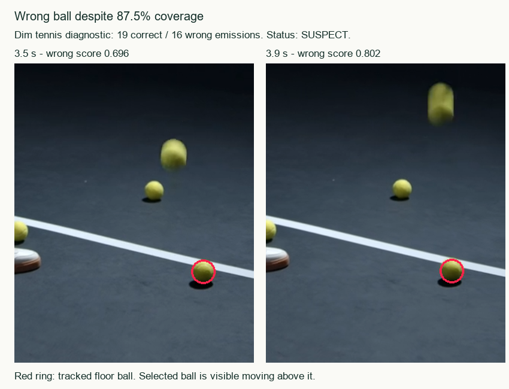

# Validation on additional balls and conditions - October 14, 2026

**Verdict: automatic tracking is not validated as trustworthy.** Loss handling prevented the old bottle/cone substitutions in these replay windows, but a new real clip still switches to a floor ball after two missing samples. A diagnostic longer window reaches 87.5% coverage despite 16 wrong-object detections. Default `SUSPECT`/`UNMEASURABLE` status protects against an automatic quality pass; it does not prove object identity.

## What was tested

66 main browser runs: 33 cases each through the installed YOLOX nano ONNX detector and the colour fallback. Cases comprise 11 new public real videos, seven existing regression sources, three additional full 30-second windows on those sources, and 12 generated controls. Real ball types include patterned/coloured footballs, tennis balls, basketballs and volleyballs. Conditions include night, dim indoor lighting, actual rain/wet court, tree shade, hard sunlight, clutter, camera movement, motion blur, small balls, look-alike floor balls, occlusion and frame exits.

Two additional detector runs are kept separate: a longer dim-tennis diagnostic and a repeated/re-encoded volleyball compute benchmark. A third additional run tested actual-model cancellation. An unavailable night-game download is excluded, with its failure retained in `sources.json`.

Production tracker code and thresholds were frozen during these runs. `code-version.json` contains SHA-256 hashes checked by `check.py`. Each saved analysis contains source SHA-256 and dimensions. Runs used an isolated Validation profile on port 8784, actual ONNX inference, 10 samples/second and the app's select/track controls. Colour fallback was forced only in that evaluation browser. Every loss prompt was answered by skipping the remaining direction; no reseeds or player assessments were created. Model selection time is excluded from reported tracking elapsed time.

**Labelling limits:** this is an implementer-led, non-blind visual identity audit, not independent coach validation. Every emitted real-video prediction in the main batches was viewed on exact browser-decoded frames; native crops were inspected for the tiny rain ball and tennis floor switch. `audit.json` records reviewed indices, wrong/uncertain indices and hashes of the exact analyses. These labels say whether a point lies on the selected object, not an independently measured centre-position error or visible-frame recall. Missing real samples were not labelled visible/absent/occluded. Generated controls have exact position/visibility truth, explicitly marked non-independent. No thresholds were fitted.

An initial pass used FFmpeg fps-resampled previews to select seeds. Those preview frames did not correspond to the requested paused timestamps. That pass and its seeds are retained as `runs-initial-invalid-seeds.json` and `reference-initial-invalid-previews.json` and excluded. New-source seeds below were corrected from the actual paused browser frames before rerunning both methods. This correction did not change the tracker.



## New real-video results

Coverage is emitted samples divided by every sample in the selected window. Correct/wrong below refers only to emitted-object identity, not accuracy on all visible frames. Refused means selection was rejected; it is not a successful track. Exact windows, seeds, dimensions, scores and errors are retained in `reference.json`, `runs-*.json` and `results.json`.

| Case | Detector coverage | Detector correct / wrong | Colour coverage | Colour correct / wrong |
|---|---:|---:|---:|---:|
| night-kick | 28/40 (70.0%) | 28 / 0 | 15/40 (37.5%) | 15 / 0 |
| urban-juggle | Refused | - | Refused | - |
| park-juggle | 17/30 (56.7%) | 17 / 0 | 4/30 (13.3%) | 4 / 0 |
| studio-juggle | 9/50 (18.0%) | 9 / 0 | Refused | - |
| rain | 2/30 (6.7%) | 2 / 0 | Refused | - |
| tennis-day | Refused | - | 39/40 (97.5%) | 39 / 0 |
| tennis-dark | 25/30 (83.3%) | 9 / 16 | 11/30 (36.7%) | 11 / 0 |
| basket-outdoor | Refused | - | 3/40 (7.5%) | 3 / 0 |
| basket-indoor | Refused | - | Refused | - |
| volley-dark | 39/40 (97.5%) | 39 / 0 | Refused | - |
| volley-beach | Refused | - | Refused | - |
| basket-outdoor-30s | Refused | - | 3/300 (1.0%) | 3 / 0 |

The detector accepted six of the 11 new unique videos and refused five. New-source emissions were 104 correct and 16 wrong out of 120. This excludes the repeated basketball window, which the detector refused. This conditional identity count is not a general accuracy estimate: refusals/misses are common, samples are temporally correlated, and the audit is not independent.

- **Night kick:** all 28 detections are on the ball; tracking stops at the edge exit at 2.8 s. Correct detections can score as low as 0.238.
- **Rain:** both detections are on the roughly 12-pixel ball; only 2/30 samples are emitted, then the app asks for reconfirmation at 4.4 s. This is inadequate tracking coverage, not rain robustness.
- **Dark studio football:** nine correct detections, then loss at 1.1 s. No switch to one of the static floor balls in this window; coverage is only 18%.
- **Dim tennis:** indices 14-29 (3.4-4.9 s) are on a static floor ball while the selected ball bounces elsewhere. The tracker had only two consecutive misses (3.2, 3.3 s), so the three-miss loss rule did not fire. Wrong scores span 0.571-0.802. Motion of the camera also moves the floor ball's screen position, weakening stationary-screen diagnostics.
- **Longer dim-tennis follow-up (1-5 s):** 35/40 emitted (87.5%), 19 correct and the same 16 wrong. It passes the coverage gate and remains `SUSPECT` because correctness limits are unset. This is a targeted follow-up on an observed failure, not another held-out clip.
- **Volleyball:** 39/40 correct emissions in dim light, but mostly a held/manipulated ball. This is not evidence of football juggling contacts.
- **Refused balls:** exact paused-frame seeds on the urban orange football, bright tennis ball, two basketballs and beach volleyball were rejected by the detector. Colour fallback handled the bright tennis ball well in this short hand-toss window, but most other accepted fallback clips ended quickly.

## Existing regressions and natural long windows

| Case | Detector coverage | Detector correct / wrong | Colour coverage | Colour correct / wrong |
|---|---:|---:|---:|---:|
| regression-beach | 13/30 (43.3%) | 13 / 0 | 13/30 (43.3%) | 13 / 0 |
| regression-futsal | 30/30 (100.0%) | 30 / 0 | Refused | - |
| regression-u17 | 21/30 (70.0%) | 21 / 0 | 21/30 (70.0%) | 21 / 0 |
| regression-street | Refused | - | Refused | - |
| regression-aerial | 14/30 (46.7%) | 14 / 0 | Refused | - |
| aerial-30s | 14/300 (4.7%) | 14 / 0 | Refused | - |
| regression-tennis | 7/30 (23.3%) | 7 / 0 | 7/30 (23.3%) | 7 / 0 |
| regression-improvised | Refused | - | Refused | - |
| improvised-30s | Refused | - | Refused | - |

The bottle regression (u17) emits only the 21 ball points and stops before reacquiring the bottle; the cone/scene-cut regression emits seven pre-cut ball points and stops. Beach tracking still loses the ball at the kick. The 100% futsal result is a stationary floor ball: correct identity, but no juggling evidence. The improvised wide shot has no reliably visible seed ball and serves as an abstention case, not a correctly selected ball detection test.

The natural 30-second aerial window yields just 14/300 samples; improvised football is refused. The long outdoor-basketball fallback yields just 3/300. None validates a complete natural 30-second juggling run. Duplicate emissions from longer windows are included in run totals but are not independent observations.

Across all main accepted real detector runs, 203/219 emitted points are on the selected ball and 16 are on the wrong ball. Across accepted real fallback runs, all 116 emitted points were visually on the selected ball. The low coverage and selection refusals prevent interpreting these conditional counts as full-window performance or superiority of fallback.

## Generated controls

These are rendered moving markers, not photographed athletes or genuine weather. They isolate policy/trajectory behaviour. The learned detector rejected all 12 at selection, so they do not establish that model's recognition accuracy. For the fallback, exact generated labels were scored with `tools/evaluate_tracks.py --allow-implementer`:

| Control | Emitted / samples | Correct | Wrong | Missed visible | Correct absent | Occluded samples |
|---|---:|---:|---:|---:|---:|---:|
| control-football | 36/40 | 36 | 0 | 4 | 0 | 0 |
| control-basket | Refused | - | - | - | - | - |
| control-tennis | Refused | - | - | - | - | - |
| control-small | Refused | - | - | - | - | - |
| control-fast | 30/40 | 30 | 0 | 10 | 0 | 0 |
| control-dark | 36/40 | 36 | 0 | 4 | 0 | 0 |
| control-rain | 36/40 | 36 | 0 | 4 | 0 | 0 |
| control-blur | 40/40 | 40 | 0 | 0 | 0 | 0 |
| control-occlusion | 14/40 | 14 | 0 | 21 | 5 | 0 |
| control-edge-decoy | 20/40 | 19 | 0 | 0 | 18 | 3 |
| control-cut-decoy | 40/40 | 15 | 25 | 0 | 0 | 0 |
| control-30s | 270/300 | 270 | 0 | 30 | 0 | 0 |

**Continuous scene-cut decoy fails:** the selected marker disappears at 1.5 s and an identical nearby decoy appears. The tracker emits every sample (100% coverage), including 25 wrong-object points. There is no missing-detection gap to trigger confirmation. The edge-exit control stops with zero wrong points, but one emission occurs during partially occluded edge visibility and is excluded from correct-position precision. After the five-sample occlusion the fallback abstains until the end, losing 21 subsequent visible samples without reseeding. Fast control coverage falls to 75%; the 10-pixel-diameter ball is refused.

## Contacts

Contact accuracy and foot labels remain unvalidated on this new set. The new studio run loses the ball early and proposes no contacts. The bright tennis hand-toss fallback proposes two contacts with unknown foot; these are not football foot-contact evidence. Generated smooth trajectories have no actual contacts or body model, yet the clear/dark/rain/blur/long controls propose turns as contacts (e.g. four for the blur control and 30 for the long control). These are false physical contact proposals against empty generated-contact truth. Some are marked uncertain, others are not. This confirms the need for body/foot evidence and human review; trajectory turns alone cannot establish foot contact.

The earlier indoor-reference contact improvement in TESTING.md remains a replay of frozen detections, not fresh independent contact validation. No left/right pose evidence or independent contact precision/recall is claimed here.

## Speed, progress and software policy

The compute-only 30-second benchmark loops the first four seconds of the new dark-volleyball source and re-encodes it with frequent keyframes. Actual YOLOX nano inference processed **all 300 samples in 50.772 seconds**, emitting 292 (97.3%), with no loss prompts or page errors. This is 0.169 seconds per sample end-to-end on this machine after model loading. It measures sustained work, not natural juggling correctness, and the re-encode makes it unsuitable as a decoding benchmark for original VP9 or irregular-timestamp uploads. Main-run elapsed times are retained but were sometimes concurrent with frame capture and must not be used for a before/after speed claim.

A separate actual-model run showed advancing progress at 5/300 and 12/300 samples. Cancelling restored media/select controls and playback controls in 704 ms, returned `Analysis cancelled.`, created no analysis, and left assessments at zero. Evidence is in `cancel-results.json` and `cancel-progress.png`.

`python evaluation/validation-2026-10-14/check.py` passes for detector, fallback, follow-up and benchmark. It asserts zero page errors, no assessments, chronological/full-window sample records, no emission beyond a skipped loss boundary, no reseeds, unset/unvalidated correctness limits, `SUSPECT` or `UNMEASURABLE` only, frozen code hashes, complete identity-audit indices/analysis hashes and existing exact-frame evidence. This validates those software policies, not general tracking accuracy. The preceding implementation run's 54 Python tests, 44 JS tests and five browser callbacks remain separate software checks. No production code changed during this evaluation.

## Artifacts and reproduction

`reference.json` freezes cases and seeds; `sources.json` records new source pages, authors, download URLs and SHA-256; `controlled-sources.json` and `benchmark-source.json` describe derivatives. Old-source attribution/references remain in `evaluation/conditions-footage` and `evaluation/other-footage`. Public Pexels sources are linked there under the [Pexels licence](https://www.pexels.com/license/). Raw videos, saved analyses, browser captures, native crops and contact sheets are under `test-results/validation-2026-10-14/`. They are local diagnostic artifacts, not new player records.

With the existing isolated Validation data directory and installed model, start:

```powershell
python app.py --port 8784 --data-dir test-results/validation-2026-10-14/app-data
```

In another terminal (Playwright installed, Edge available):

```powershell
node evaluation/validation-2026-10-14/run.js 8784 detector
node evaluation/validation-2026-10-14/run.js 8784 colour
python evaluation/validation-2026-10-14/check.py
```

Default runs exclude diagnostic/benchmark follow-ups. Set `ONLY=tennis-dark-high-coverage` and use label `followup`, or `ONLY=benchmark-volley-loop-30s` and label `benchmark`, to run those explicitly. Re-running overwrites the corresponding raw run JSON; a changed production version or analysis will require a new visual audit rather than reusing this ledger. Set `ALL_FRAMES=1` and matching `ONLY` cases for `capture.js`, then `python evaluation/validation-2026-10-14/sheets.py` for audit evidence. The browser-facing scripts currently expect port 8784 except `run.js`, which accepts the port argument. Generation/setup scripts are diagnostic utilities for this isolated profile, not production code.

## Required before trusting results

Close the two-sample reacquisition and continuous-decoy identity failures; collect several independently and blindly labelled real clips per condition with visible/absent/occluded states, contacts and foot labels; reserve a held-out split; include complete natural 30-second juggling windows; then calibrate correctness limits and evaluate rejection and error rates together. This run supplies a reproducible failure set, not the independent human labels needed to choose thresholds.
